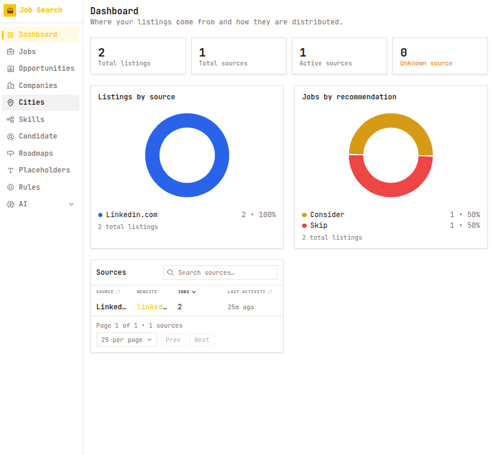
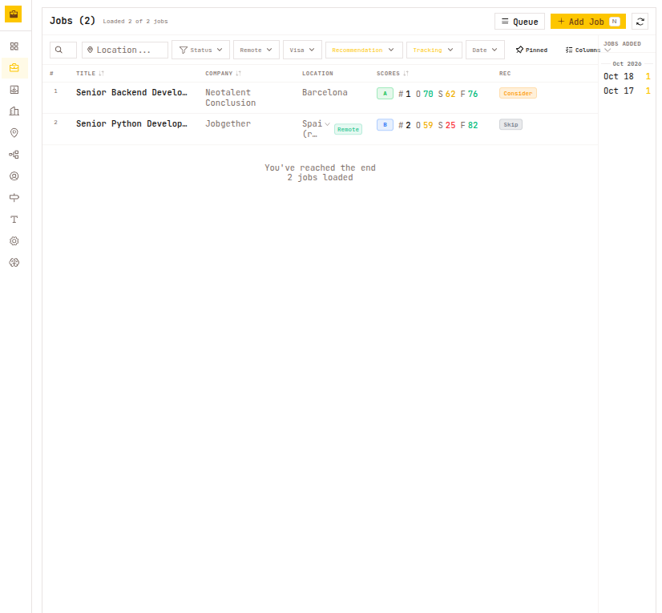
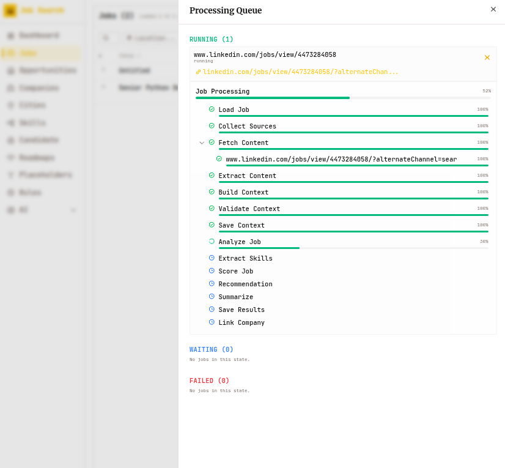

# Job Search Intelligence

AI-powered career platform for software engineers — job discovery, company analysis, skill management, and career insights. Built for visa-sponsored roles in Europe (Germany, Netherlands).

## Screenshots

| Dashboard | Jobs |
|-----------|------|
|  |  |

**Real-time job processing** — live, step-by-step pipeline progress while a job is fetched, analyzed and scored:



## Quick Start

### Local Development (recommended)

```bash
./start migrate   # apply DB migrations first (migrations never run on app startup)
./start           # then start the apps
```

Opens FastAPI backend (port 5000) + Next.js frontend (port 5173) + background workers (TaskIQ + Redis).

### Terraform (Docker-based)

```bash
./start terraform build    # build Docker images (first time only)
./start terraform up       # provision all infrastructure
```

Opens the same services but fully containerized. Ports differ to avoid conflicts:

| Service | Local Dev | Terraform |
|---------|-----------|-----------|
| PostgreSQL | 5432 | 5433 |
| Redis | 6379 | 6380 |
| Backend | 5000 | 5000 |
| Frontend | 5173 | 5173 |

Data persists across `terraform destroy` / `terraform up` cycles via an external Docker volume. See [`terraform/README.md`](terraform/README.md) for full docs.

```bash
./start terraform down     # destroy containers (keeps data)
./start terraform status   # show service URLs
./start terraform logs     # tail all container logs
```

Opens FastAPI backend (port 5000) + Next.js frontend (port 5173) + background workers (TaskIQ + Redis).

Both apps run in **reload mode**: backend via uvicorn `--reload`, frontend via `next dev`. Code changes reload automatically; **test files are excluded** — editing `apps/backend/tests/` or frontend `*.test.*` files does not restart the apps. The backend's graceful shutdown is bounded to 5s so a long-lived SSE stream (e.g. the open Processing Queue drawer) can't block a reload. Pass `-b/--background` to also start the background worker + scheduler (the scheduler takes a DB backup every `DB_BACKUP_INTERVAL_MINUTES` and keeps the `DB_BACKUP_KEEP_COUNT` most recent dumps — see `.env`).

## Tech Stack

| Layer | Technology |
|-------|-----------|
| Backend | Python 3.14+, FastAPI, PostgreSQL (SQLAlchemy ORM + Alembic) |
| Frontend | React 18, Next.js (App Router), TypeScript, shadcn/ui, Tailwind CSS |
| AI | LLMService (OpenAI / Mimo CLI / Local via `AI_PROVIDER`), LangGraph workflows |
| Queue | TaskIQ + Redis for background processing |
| Realtime | Server-Sent Events (SSE, `/api/sse/processing-events`) |
| Testing | pytest (1145+ backend), vitest (297+ frontend) |
| API Docs | Swagger UI (`/api/docs`), ReDoc (`/api/redoc`) |

## Architecture

```
                     ┌──────────────────────────────┐
                     │    Next.js (App Router)       │
                     │   ┌──────┐ ┌──────────┐      │
                     │   │ Jobs │ │Companies │      │
                     │   ├──────┤ ├──────────┤      │
                     │   │Skills│ │   ...    │      │
                     │   ├──────┤ ├──────────┤      │
                     │   │Rules │ │  ...     │      │
                     │   └──────┴────────────┘      │
                     │   FSD: entities/features/    │
                     │        widgets/shared         │
                     └──────────────┬───────────────┘
                                    │ HTTP + SSE
                     ┌──────────────┼───────────────┐
                     │    FastAPI (port 5000)         │
                     │  ┌──────┐ ┌──────┐ ┌──────┐  │
                     │  │ Jobs │ │Comp. │ │Skills│  │
                     │  ├──────┤ ├──────┤ ├──────┤  │
                     │  │Rules │ │ AI   │ │Shared│  │
                     │  └──┬───┘ └──┬───┘ └──────┘  │
                     │     └────────┴──┐             │
                     │          ┌──────▼──────┐      │
                     │          │ PostgreSQL   │      │
                     │          └──────┬──────┘      │
                     └─────────────────┼─────────────┘
                                        │
                     ┌──────────────────┼──────────────────┐
                     │    TaskIQ Worker  │     Redis        │
                     │  (background/)    │  (broker + SSE)  │
                     └──────────────────┴──────────────────┘
                                        │
                     ┌──────────────────▼──────────────────┐
                     │       AI Agent Layer (LLMService)    │
                     │    LangGraph workflows + Providers    │
                     │  ┌──────┬──────┬──────┬──────────┐   │
                     │  │OpenAI│ Mimo │Local │ Anthropic│   │
                     │  └──────┴──────┴──────┴──────────┘   │
                     └─────────────────────────────────────┘
```

## Navigation

```
Jobs              Job processing queue + processed cards
Companies         Company intelligence + processing queue
Skills            Skill management, aliases, insights
Rules             Scoring rules configuration
```

## Features

### Job Processing
- URL/notes submission → fetch → extract → AI analysis → score → save
- Two-phase LangGraph pipeline: LLM-free context preparation, then a single combined `job.analyze` call (fields, scores, recommendation, summary, tagged skills)
- Real-time SSE progress (step-by-step updates across 13 visible workflow steps)
- Analysis stored in the `job_analysis` table and surfaced in the Job Details drawer
- Configurable scoring rules (SHARED, JOB, COMPANY_PRODUCT, COMPANY_RECRUITING)
- Version tracking for retries, deduplication by base URL

### Job Analysis
- Single LLM call (`job.analyze`) via `LLMService.generate_structured` — the only AI call in the v2 pipeline
- Deterministic scoring: `overall = fit × 0.6 + success × 0.4`, recommendation `apply ≥ 80 / consider ≥ 60 / skip`
- Skills tagged `matched` / `missing` / `low` with level, category, and evidence
- Persisted to `job_analysis` (canonical) + `jobs` projection + `summaries` (legacy grade)

### Company Intelligence
- Multi-source input (notes + links) for profile extraction
- Product vs Recruiting classification, visa friendliness assessment
- Fit/Success/Overall scoring (A++ to D)

### Skills Management
- 5 categories: Technical, Engineering, Professional, Domain, Career
- Skill aliases/merge, drag-and-drop reorganization
- AI-powered insights (market relevance, confidence)

## API Documentation

- **Swagger UI**: `http://localhost:5000/api/docs`
- **ReDoc**: `http://localhost:5000/api/redoc`
- **OpenAPI Spec**: `http://localhost:5000/api/openapi.json`

## Realtime Events (SSE)

Processing progress is delivered through Server-Sent Events at `/api/sse/processing-events`:

| Event | Direction | Purpose |
|-------|-----------|---------|
| `execution.created` / `execution.started` | Server→Client | Execution created / running |
| `workflow.step.started` / `workflow.step.progress` | Server→Client | Per-step progress (Load Job → Analyze Job → Save Results) |
| `workflow.step.completed` / `workflow.step.failed` | Server→Client | Step finished / failed |
| `execution.completed` | Server→Client | Job finished; frontend refetches Job Details (analysis block) |
| `execution.failed` / `execution.cancelled` | Server→Client | Execution failed / cancelled |

## Project Structure

```
app/
├── server/                    # Python FastAPI backend (DDD modular monolith)
│   ├── entrypoints/           # FastAPI app + CLI
│   ├── shared/                # Shared Kernel (domain, application, infrastructure)
│   ├── jobs/                  # Jobs bounded context
│   ├── companies/             # Companies bounded context
│   ├── skills/                # Skills bounded context
│   ├── rules/                 # Rules bounded context
│   ├── ai/                    # AI bounded context (LLM, LangGraph, providers)
│   ├── processing/            # Processing bounded context (executions, queue)
│   └── tests/                 # 1145+ tests by bounded context
├── client/                    # Next.js frontend (FSD architecture)
│   └── src/
│       ├── app/               # App providers
│       ├── entities/          # Business entities (job, company, skill, etc.)
│       ├── features/          # Feature slices (jobs, companies, skills, etc.)
│       ├── widgets/           # Page adapters, drawers
│       └── shared/            # API client, UI kit, hooks
├── alembic/                   # Database migrations
└── start                      # Dev CLI (backend + frontend + worker)
docs/                          # Full documentation index
```

## Testing

```bash
# Backend (1145+ tests)
uv run pytest apps/backend/tests/ -v

# Frontend (297+ tests)
cd apps/frontend && npx vitest run

# All
uv run pytest apps/backend/tests/ -v && cd apps/frontend && npx vitest run

# Or via the dev CLI:
./start test backend
./start test frontend
./start test all
./start test backend --coverage   # with coverage report
./start test frontend --coverage
```

## Documentation

Key files:

| File | Purpose |
|------|---------|
| `docs/context.md` | Project context, target users, key rules |
| `AGENTS.md` | Coding rules, architecture, agent workflow |
| `docs/api/API.md` | API overview |
| `docs/architecture/overview.md` | System design overview |
| `docs/domain/overview.md` | Core entities and business rules |
| `docs/ux/DESIGN.md` | Product & UX design |
| `terraform/README.md` | Terraform Docker deployment docs |
| `docs/architecture/` | Full system design, DDD contexts, runtime |
| `docs/ai/` | AI bounded context, providers, graphs |
| `docs/api/` | Per-context API reference |
| `docs/domain/` | Domain model documentation |
| `docs/ux/` | UX feature and flow documentation |
