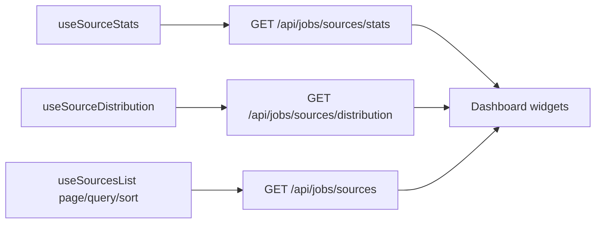

# Dashboard — Job Sources Overview

## Purpose

A fast overview of where the user's job listings come from (job boards /
recruitment sites), with per-source counts, a distribution chart, and a
searchable paginated source table. Entry point in the sidebar as
**Dashboard** (`/dashboard`).

Backend: `GET /api/jobs/sources/stats`, `GET /api/jobs/sources/distribution`,
`GET /api/jobs/sources` (see `docs/api/jobs/job-sources-dashboard.md`).

## Design principles

- Real backend aggregates only — no client-side job fetching to compute counts.
- Source identity = canonical hostname of the job's URL (see backend doc for
  the canonicalization rules); jobs without a resolvable site land in the
  "Unknown" bucket.
- All widgets share one counting definition: non-deleted jobs of the current
  user, grouped by their source site.

## High-level layout tree

```
└── /dashboard
    ├── MetricRow
    │   ├── Total listings
    │   ├── Total sources
    │   ├── Active sources
    │   └── Unknown-source listings
    ├── SourceDistributionChart (doughnut, top 5 + Other)   [desktop: right of table]
    └── SourcesTable
        ├── Toolbar (search)
        ├── Columns: Source | Website | Jobs | Last activity
        └── Pagination (page n of m • total)
```

## Wireframe

```
┌────────────────────────────────────────────────────────────────────┐
│ Dashboard                                                          │
│                                                                    │
│ ┌─────────────┐ ┌─────────────┐ ┌─────────────┐ ┌─────────────────┐ │
│ │ 1,258       │ │ 14          │ │ 12          │ │ 23              │ │
│ │ Total       │ │ Total       │ │ Active      │ │ Unknown source  │ │
│ │ listings    │ │ sources     │ │ sources     │ │ listings        │ │
│ └─────────────┘ └─────────────┘ └─────────────┘ └─────────────────┘ │
│                                                                    │
│ ┌──────────────────────────────┐  ┌───────────────────────────────┐ │
│ │ Listings by source           │  │ Sources                       │ │
│ │  (doughnut)                  │  │ [ Search sources…        ]    │ │
│ │   ● Indeed      412  36%     │  │ ┌───────────────────────────┐ │ │
│ │   ● LinkedIn    284  25%     │  │ │ Source  │ Site  │Jobs│Seen │ │ │
│ │   ● StepStone   190  17%     │  │ ├───────────────────────────┤ │ │
│ │   ● Other       182  16%     │  │ │indeed.com (link) 412  Oct │ │ │
│ │   ● Unknown     113  10%     │  │ │linkedin.com (link) 284    │ │ │
│ │   Legend: top 5 + Other      │  │ │ …                         │ │ │
│ └──────────────────────────────┘  │ └───────────────────────────┘ │ │
│                                   │ Page 1 of 2 • 14 sources      │ │
│                                   │ [Prev] Page 1 [Next]          │ │
│                                   └───────────────────────────────┘ │
└────────────────────────────────────────────────────────────────────┘
```

## States

| State  | Behavior |
| ------ | -------- |
| Loading | Metric cards show pulse placeholders; chart/table show "Loading…" rows. |
| Empty  | Chart/table render "No sources yet — import jobs to populate the dashboard." |
| Error  | Section shows the error message with a Retry button (per-widget retry, not page reload). |
| Chart zero dataset | Doughnut hidden; textual summary says no data. |

## Chart rules

- Doughnut (recharts `PieChart` + `innerRadius`), top **5** sources individually,
  remainder merged into **Other**; Unknown shown as its own slice when present.
- Percentages use the **total non-deleted listings of the user** as denominator.
- Legend lists slice + count (accessible summary is a text list).
- Same data as the table (same endpoint constants and counting rules).

## Sources table

- Server-side pagination (offset), search on name/normalized domain,
  sort by `job_count` (default `desc`), `name`, or `last_activity`.
- `Last activity` = newest job `created_at` for that source.
- Website column links to the actual canonical URL (no invented URLs).
- Responsive: cards collapse to a vertical list under 640px.

## Data flow


