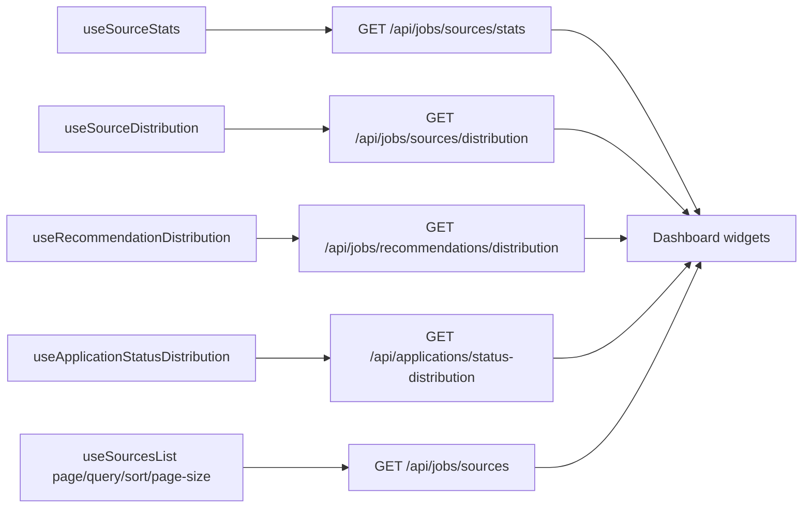

# Dashboard — Job Sources Overview

## Purpose

A fast overview of where the user's job listings come from (job boards /
recruitment sites), with per-source counts, distribution charts, and a
searchable paginated source table. Entry point in the sidebar as
**Dashboard** (`/dashboard`).

Backend: `GET /api/jobs/sources/stats`, `GET /api/jobs/sources/distribution`,
`GET /api/jobs/sources`, `GET /api/jobs/recommendations/distribution` (see
`docs/api/jobs/job-sources-dashboard.md`) and
`GET /api/applications/status-distribution` (see
`docs/api/applications/README.md`).

## Design principles

- Real backend aggregates only — no client-side job fetching to compute counts.
- Source identity = canonical hostname of the job's URL (see backend doc for
  the canonicalization rules); jobs without a resolvable site land in the
  "Unknown" bucket.
- All widgets share one counting definition: non-deleted jobs of the current
  user, grouped by their source site.
- Application-status counts are user-scoped application records (one per
  tracked job), not job listings.

## High-level layout tree

```
└── /dashboard
    ├── MetricRow
    │   ├── Total listings
    │   ├── Total sources
    │   ├── Active sources
    │   └── Unknown-source listings
    ├── SourceDistributionChart (doughnut, top 5 + Other)
    ├── RecommendationChart (doughnut: Apply / Consider / Skip / No analysis)
    ├── ApplicationStatusChart (doughnut: Not applied / Applied / Interview / Offer / Accepted / Rejected / Other statuses)
    └── SourcesTable
        ├── Toolbar (search)
        ├── Columns: Source | Website | Jobs | Last activity
        └── Pagination (page n of m • total • per-page selector 10–100 step 10, default 10)
```

## Wireframe

```
┌────────────────────────────────────────────────────────────────────┐
│ Dashboard                                                          │
│                                                                    │
│ ┌─────────────┐ ┌─────────────┐ ┌─────────────┐ ┌─────────────────┐ │
│ │ 1,258       │ │ 14          │ │ 12          │ │ 23              │ │
│ │ Total       │ │ Total       │ │ Active      │ │ Unknown source  │ │
│ │ listings    │ │ sources     │ │ sources     │ │ listings        │ │
│ └─────────────┘ └─────────────┘ └─────────────┘ └─────────────────┘ │
│                                                                    │
│ ┌──────────────────────────────┐  ┌───────────────────────────────┐ │
│ │ Listings by source           │  │ Jobs by recommendation        │ │
│ │  (doughnut)                  │  │  (doughnut)                   │ │
│ │   ● Indeed      412  36%     │  │   ● Apply        12  55%      │ │
│ │   ● LinkedIn    284  25%     │  │   ● Consider      7  32%      │ │
│ │   ● StepStone   190  17%     │  │   ● Skip          3  14%      │ │
│ │   ● Other       182  16%     │  │   22 total listings           │ │
│ │   ● Unknown     113  10%     │  └───────────────────────────────┘ │
│ └──────────────────────────────┘                                    │
│ ┌──────────────────────────────┐  ┌───────────────────────────────┐ │
│ │ Applications by status       │  │ Sources                       │ │
│ │  (doughnut)                  │  │ [ Search sources…        ]    │ │
│ │   ● Not applied   5 18%      │  │ ┌───────────────────────────┐ │ │
│ │   ● Applied      12  43%     │  │ │ Source  │ Site  │Jobs│Seen │ │ │
│ │   ● Interview     4  14%     │  │ ├───────────────────────────┤ │ │
│ │   ● Offer         1   4%     │  │ │indeed.com (link) 412  Oct │ │ │
│ │   ● Accepted      2   7%     │  │ │linkedin.com (link) 284    │ │ │
│ │   ● Rejected      3  11%     │  │ │ …                         │ │ │
│ │   ● Other statuses 1  4%     │  │ └───────────────────────────┘ │ │
│ │   28 total applications      │  │ └───────────────────────────┘ │ │
│ └──────────────────────────────┘  │ Page 1 of 2 • 14 sources      │ │
│                                   │ [Prev] Page 1 [Next]          │ │
│                                   └───────────────────────────────┘ │
└────────────────────────────────────────────────────────────────────┘
```

The page fills the shared app-shell content area edge-to-edge with only a small
horizontal gutter (`px-2`, `lg:px-3`); there is no fixed max-width cap
(`docs/ux/app-shell.md`), so the metric row, chart panels and Sources table use
the full width on wide monitors.

## States

| State  | Behavior |
| ------ | -------- |
| Loading | Metric cards show pulse placeholders; charts/table show pulse or "Loading…" rows. |
| Empty  | Source/table charts say "No sources yet — import jobs to populate the dashboard."; the application chart says "No applications yet — track a job to populate this chart." |
| Error  | Section shows the error message with a Retry button (per-widget retry, not page reload). |
| Chart zero dataset | Doughnut hidden; textual summary says no data. |

## Chart rules

- Doughnut (recharts `PieChart` + `innerRadius`), top **5** sources individually,
  remainder merged into **Other**; Unknown shown as its own slice when present.
- Percentages use the **total non-deleted listings of the user** as denominator.
- Legend lists slice + count (accessible summary is a text list).
- Same data as the table (same endpoint constants and counting rules).

## Recommendation chart

- Second doughnut ("Jobs by recommendation") beside the source distribution:
  one slice per bucket `apply | consider | skip | none` (jobs whose analysis
  produced that recommendation; `none` covers unprocessed jobs, absent
  recommendation, or legacy labels — `GET /api/jobs/recommendations/distribution`).
- Fixed semantic colors: green (apply), amber (consider), red (skip), gray (none).
- Zero-count buckets are hidden; empty dataset shows
  "No recommendations yet — process jobs to populate this chart."

## Application status chart

- Third doughnut ("Applications by status") beside the recommendation chart:
  counts the current user's application records by funnel status
  (`GET /api/applications/status-distribution`).
- **Not applied** (amber) leads the chart: one slice aggregating every
  pre-submission status (`seen`, `preparing`, `ready_to_apply`), so the legend
  answers "how many tracked applications have not been sent yet?" at a glance.
- Then the five most important outcomes in fixed order — **Applied**
  (green), **Interview** (cyan), **Offer** (purple), **Accepted** (emerald),
  **Rejected** (red). Every remaining terminal status (`withdrawn`, `expired`)
  is folded into a single gray **Other statuses** slice so no tracked
  application is lost.
- Percentages use **all applications** as the denominator. Zero-count slices
  are hidden; empty dataset shows
  "No applications yet — track a job to populate this chart."
- Counts are user-scoped and read-only; the endpoint creates no events.

## Sources table

- Server-side pagination (offset), default **10** rows, per-page selector in
  steps of 10 (10 / 20 / 30 / … / 100; changing it resets to page 1), search on
  name/normalized domain, sort by `job_count` (default `desc`), `name`, or
  `last_activity`.
- `Last activity` = newest job `created_at` for that source.
- Website column links to the actual canonical URL (no invented URLs).
- Responsive: cards collapse to a vertical list under 640px.

## Data flow


