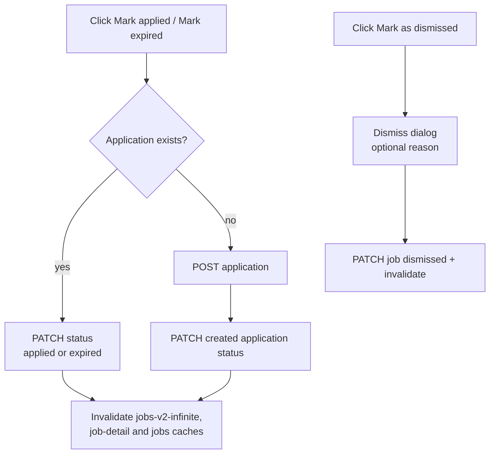
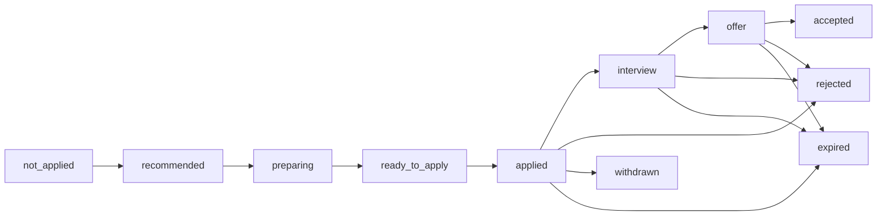

# Job Tracking Status

## Purpose

The Jobs page shows a **Tracking** column and filter that reflect where each job
stands in the **application funnel**: not applied → applied → interview → offer →
accepted (or rejected / withdrawn / expired). The tracking status is derived from the
job's **application status** (the Applications context); a job with no
application shows **Not Applied**. It complements the existing **Status**
(processing) column rather than replacing it.

## Source of Truth

The tracking status is the application's status (`application.applications.status`).
Values:

| Value | Meaning |
| ----- | ------- |
| `not_applied` | The job has no application record (derived, not stored). |
| `seen` | Application created; not yet prepared. |
| `preparing` | Preparing materials. |
| `ready_to_apply` | Materials ready; not yet submitted. |
| `applied` | Application submitted. |
| `interview` | Interviewing with the company. |
| `offer` | Received an offer. |
| `accepted` | Offer accepted / hired. |
| `rejected` | Rejected by the company. |
| `withdrawn` | Application withdrawn. |
| `expired` | Posting-side terminal: the job is no longer accepting applications. |

The tracking value is **not stored on the job** (no new job column). It is
resolved on read by the Jobs API via the application repository (logical
`job_id` reference, AGENTS.md rule 15).

## Jobs List (column + filter)

```text
┌───────┬───────────┬─────────┬─────────┬─────────┬──────────┬─────────┬───────────┬───────────┬─────────┐
│ Title │ Company   │ Location│ Scores  │ Rec     │ Tracking │ Status  │ Updated   │ Created   │ Actions │
├───────┼───────────┼─────────┼─────────┼─────────┼──────────┼─────────┼───────────┼───────────┼─────────┤
│ Staff │ Acme GmbH │ Berlin  │ A+ F85  │ Apply   │ [Applied]│ Running │ 2m ago    │ 1d ago    │  ⋯      │
│ SWE   │           │         │ S88 O90 │         │          │         │           │           │         │
├───────┼───────────┼─────────┼─────────┼─────────┼──────────┼─────────┼───────────┼───────────┼─────────┤
│ Kafka │ DataOps   │ Remote  │ B  F72  │ Consider│ [Interview]│ Completed│ 5m ago  │ 3d ago    │  ⋯      │
│ Eng   │           │         │ S80 O75 │         │          │         │           │           │         │
└───────┴───────────┴─────────┴─────────┴─────────┴──────────┴─────────┴───────────┴───────────┴─────────┘
```

- **Tracking column**: a color-coded badge (`TrackingBadge`) between the Rec and
  Status columns. Jobs without an application show the gray **Not Applied** badge.
- **Tracking filter** (`JobsToolbar`): a select labeled **Tracking** with options
   All / Not Applied / Applied / Interview / Offer / Accepted / Rejected / Withdrawn / Expired.
  It maps to the `tracking_status` query param on `GET /api/jobs/list` and counts
  toward the active-filter count / Clear button.

### Filter semantics

- `tracking_status=not_applied` → excludes every job that has an application.
- `tracking_status=<status>` → returns only jobs whose application status matches.
- Combined with the processing-status filter (e.g. `applied` + `completed`).

## Job Detail / Job Edit Drawers

Both drawers show an editable **Tracking** status (`TrackingStatusSelect`):

- **Job Detail drawer**: the "Tracking" row splits into two sub-columns that fit
  inside the drawer's own two-column grid — the **status select alone** on the
  left, and the **quick actions stacked** on the right:
  **Mark applied** → **Mark expired** → **Mark as dismissed**.
  Changing the select PATCHes the application status immediately (same mutation
  as the application workspace) and refreshes the job list/detail caches.
- **Mark applied** / **Mark expired** (`TrackingActions`) work with or without
  an existing application: they PATCH the status when one exists, otherwise they
  create the application first and then set the status (one click either way).
  Both are disabled and read "Saving…" while a mutation is in flight.
- When the job has **no application**, the select renders a disabled
  **"Not applied"** placeholder (`emptyMode="placeholder"`) — the stacked
  buttons own the actions, so no inline button is duplicated inside the row.
- **Job Edit drawer**: a "Tracking" field with the same select, independent of
  Save. There the default `emptyMode="button"` still applies, so a job without
  an application shows the inline **Mark expired** button that creates it and
  sets it to `expired` in one step (e.g. triaging a dead posting from the
  create-drawer duplicate card). The header also keeps the "Application" button
  to the workspace.

```text
Job Details — right drawer
┌──────────────────────────────────────────────────────────────────┐
│ Job Details                                          [⋮] [Edit]  │
│ Staff Engineer                                                   │
│ ┌──────────────┬──────────────────────────────────────────────┐  │
│ │ COMPANY      │ Acme GmbH                                    │  │
│ │ TRACKING     │ ┌───────────────────┐  ┌──────────────────┐  │  │
│ │              │ │ [ applied ▾     ] │  │ [ Mark applied ] │  │  │
│ │              │ └───────────────────┘  │ [ Mark expired ] │  │  │
│ │              │                        │ [Mark as dismiss]│  │  │
│ │              │                        └──────────────────┘  │  │
│ │ EMPLOYMENT   │ Full-time                                    │  │
│ └──────────────┴──────────────────────────────────────────────┘  │
└──────────────────────────────────────────────────────────────────┘

TRACKING row — one sub-column has the single select, the other stacks the
actions. The select has two branches:

  job HAS an application        job has NO application
  ─────────────────────────     ─────────────────────────
  [ applied ▾ ]  combobox       [ Not applied ]  disabled
     │                            (buttons own the actions)
     └─ PATCH status
        + invalidate jobs/detail caches

  stacked actions (with or without an application):
  [ Mark applied ] ─┐
  [ Mark expired ] ─┴─ PATCH status if one exists, else
                       POST application → PATCH status
  [ Mark as dismissed ] → opens the dismiss-reason dialog
```



## Application Workspace

The application status select (`ApplicationTracker`) and badge
(`ApplicationStatusBadge`) now include the new funnel values
`interview`, `offer`, and `accepted` alongside the existing
seen / preparing / ready_to_apply / applied / rejected / withdrawn / expired.



## Backend

- `GET /api/jobs/list` gains a `tracking_status` query param and returns a
  `tracking_status` field on each item (derived via
  `statuses_by_job_ids` / `job_ids_with_application` on the application repo).
- `GET /api/jobs/{id}` returns `tracking_status` on the detail payload.
- The application PATCH accepts the new statuses (validated against
  `ApplicationStatus.ALL`).
