```mermaid
stateDiagram-v2
    [*] --> NeedsEvaluation
    NeedsEvaluation --> Evaluated: Process scores it
    Evaluated --> Moving: Move to Jobs clicked
    Moving --> Moved: linked or job created
    Moving --> Evaluated: error (no URL / API failure) → toast
    Moved: job_id set; Links section shows the job;
           opportunities + jobs lists invalidated
```

# Opportunity Detail Drawer

## Purpose

Shows everything known about one inbound opportunity: the original message, extracted information with uncertainty, linked company/job, the current evaluation (scores + reasons), missing information, the application path, the recommended next action, and the evaluation history.

## Anatomy

```text
┌────────────────────────────────────────────────────────────┐
│ Senior Backend Engineer        [Process] [Move to Jobs] ✕  │
│ Acme GmbH · Manual · Evaluated                             │
├────────────────────────────────────────────────────────────┤
│ ┌─ Score ────────────────────────────────────────────────┐ │
│ │ Overall 79 · Fit 85 · Success 70 · consider             │ │
│ │ Technical Match 88 · Experience 92 · Location ?        │ │
│ │ Concerns: salary range is unclear                      │ │
│ └────────────────────────────────────────────────────────┘ │
│ ┌─ Next ─────────────────────────────────────────────────┐ │
│ │ Ask the recruiter for the location and JD              │ │
│ │ Path: Reply to the sender                              │ │
│ └────────────────────────────────────────────────────────┘ │
│ ┌─ Original Message ─────────────────────────────────────┐ │
│ │ "Hi Hassan, we are hiring a Senior Backend Engineer…"  │ │
│ │ Jane · jane@acme.example · Senior Backend Engineer role│ │
│ └────────────────────────────────────────────────────────┘ │
│ ┌─ Base URL ─────────────────────────────────────────────┐ │
│ │ https://www.linkedin.com/posts/jane-hiring-abc123      │ │
│ │ [Edit]                                                 │ │
│ └────────────────────────────────────────────────────────┘ │
│ ┌─ Extracted ────────────────────────────────────────────┐ │
│ │ Role: Senior Backend Engineer (known)                  │ │
│ │ Company: Acme GmbH (inferred — needs verification)     │ │
│ │ Location: unknown · Skills: Python (known)             │ │
│ │ Links: linkedin.com/posts/jane-hiring-abc123           │ │
│ └────────────────────────────────────────────────────────┘ │
│ ┌─ Linked Records ───────────────────────────────────────┐ │
│ │ Job: Senior Backend Engineer → · Company: —            │ │
│ └────────────────────────────────────────────────────────┘ │
│ ┌─ Links ────────────────────────────────────────────────┐ │
│ │ https://acme.example/careers — Careers page  [Delete]  │ │
│ │ Title [(e.g. LinkedIn post)            ]               │ │
│ │ URL  [https://…                       ]  [Add link]    │ │
│ └────────────────────────────────────────────────────────┘ │
│ ┌─ Missing ──────────────────────────────────────────────┐ │
│ │ Job location · Salary range                            │ │
│ └────────────────────────────────────────────────────────┘ │
│ ┌─ Follow-ups ───────────────────────────────────────────┐ │
│ │ Recruiter replied · Hassan · 2h ago        [Delete]    │ │
│ │ "They sent the full JD — Berlin, Germany."             │ │
│ │ Title [________________]                               │ │
│ │ [Paste the follow-up message or new details…      ]    │ │
│ │ [Add follow-up]                                        │ │
│ └────────────────────────────────────────────────────────┘ │
│ ┌─ History ──────────────────────────────────────────────┐ │
│ │ eval-2 · ready_to_apply · 79 · 2h ago                  │ │
│ │ eval-1 · needs_info · — · 1d ago                      │ │
│ └────────────────────────────────────────────────────────┘ │
├────────────────────────────────────────────────────────────┤
│ Status: [Needs Info ▾]     [Dismiss]  [Delete opportunity]   │
└────────────────────────────────────────────────────────────┘
```

## Header

| Element     | Behavior                                              |
| ----------- | ----------------------------------------------------- |
| Title       | Extracted role, else subject, else `Unknown role`.    |
| Process     | Runs extract → resolve → evaluate; button spins while running. |
| Move to Jobs| Enabled once `evaluation_status = complete`. Links the matching job or creates one from the extracted URL (scores + JD note carried over); button spins while running. After success the link shows in the Links section and the button is hidden. Unevaluated opportunities have the button disabled. |
| Close       | Closes the drawer.                                    |

## Content

Sections render only when they have content, except Score (shows `Evaluation pending` + reason) and Next (always shows the recommended action). Uncertainty is shown inline (`known` values plain; `inferred` / `needs_verification` flagged). History lists evaluation snapshots newest first.

## Follow-ups

The follow-up trail records later messages and new details for reassessment (e.g. a recruiter reply with the JD). Each note shows title (or `Note`), author display name, timestamp, content, and a delete button. The add form is a title input plus a message textarea and an `Add follow-up` button (disabled while empty). Notes are immutable — no edit. The author is stamped server-side from the signed-in user.

## Base URL

The canonical page the opportunity came from (e.g. the LinkedIn post the recruiter sent). It participates in job duplicate resolution like any extracted URL. Display shows the URL with an `Edit` action; editing swaps in an input plus `Save` (or `Saving…` while pending) and `Cancel`:

```text
Display        ┌──────────────────────────────┐   Editing      ┌──────────────────────────────┐
(default)      │ https://linkedin.com/posts/… │  (Edit)        │ [https://www.linkedin.com/…] │
               │                     [Edit]   │  ──────────▶   │            [Save] [Cancel]   │
               └──────────────────────────────┘                └──────────────────────────────┘
                      ▲  when no base URL is set the section shows        │ Save
                      │  `Not set` with the same `Edit` action           ▼
               ┌──────────────────────────────┐                ┌──────────────────────────────┐
               │ Not set              [Edit]  │  (invalid URL) │ ◤ 422 — Base URL must be an  │
               └──────────────────────────────┘                │   http(s) URL (.inline error)│
                                                               └──────────────────────────────┘
```

Invalid http(s) URLs are rejected with an inline error (422 from the API); clearing the input to empty and saving removes the base URL.

## Links

User-saved source links complement the AI-extracted URLs (which stay in Extracted; the linked job/company section above is `Linked Records`). Each link shows its URL (opens in a new tab), optional title, and a per-item `Delete` button — mirroring the notes pattern (immutable add/delete, no edit). The add form is a title input plus a URL input and an `Add link` button (label `Adding…` while pending; disabled while the URL is empty). Invalid http(s) URLs are rejected with an inline error.

```mermaid
flowchart LR
    L[Links form] -->|Add link| API[POST /{id}/links]
    API --> List[Links list grows · URL + title · per-item Delete]
    List -->|Delete| Del[DELETE /links/{link_id}] --> List
    BaseUrl[Base URL · display ⬌ edit] -->|Save| Patch[PATCH /{id}/base-url]
    Patch --> Display[Updated base URL or Not set]
```

## Dismiss

The footer has a `Dismiss` button (or `Undismiss` when dismissed, with a
`Dismissed` badge in the header). Dismissing opens a dialog:

```text
┌─ Dismiss opportunity ────────────────┐
│ Dismiss "Senior Backend Engineer"?   │
│ Hidden from the default list; the    │
│ reason is saved to Follow-ups.       │
│ [Why are you dismissing this?    ]   │
│ [Cancel]  [Dismiss]                  │
└──────────────────────────────────────┘
```

The optional reason is saved to the follow-up trail as a `Dismissed` note.
Dismissed rows are hidden from the default list; `Show dismissed` on the page
reveals them.

## Footer

Status select (funnel transitions; invalid ones rejected), dismiss/undismiss, and a delete button with confirmation.

## Move to Jobs

Manual conversion into the Jobs bounded context (`POST .../move-to-job`). States:

```text
Before evaluation        After evaluation          Once moved
┌──────────────┐        ┌──────────────┐          ┌──────────────┐
│ [Move to     │        │ [Move to     │          │ Linked to a  │
│  Jobs] off   │  →     │  Jobs] on    │   →      │ job in Jobs  │
└──────────────┘        └──────────────┘          │ (button gone)│
                          │ error                └──────────────┘
                          ▼
                 ┌──────────────────────────┐
                 │ Toast: nothing to link — │
                 │ no job URL / unevaluated │
                 └──────────────────────────┘
```


