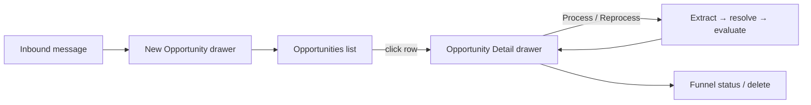
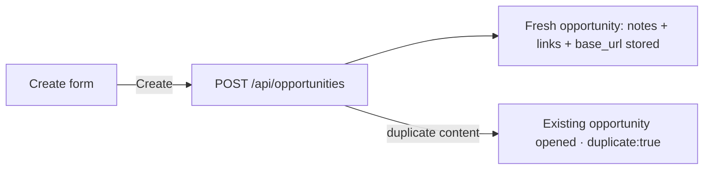

# Opportunities Page

## Purpose

The Opportunities page is the workspace for inbound recruiting messages: paste a message, watch it become a structured opportunity, and track it to an application. It complements — never replaces — the JD-first Jobs page.

Users can:

- Add a new inbound message (manual paste in phase one)
- Browse opportunities newest-first, search, filter by status/source
- Open an opportunity to see the original message, extracted info, links, evaluation, score, and next action
- Process/reprocess an opportunity when new information arrives
- Move an opportunity along the funnel; delete it

## Design Principles

- An opportunity may be incomplete — the UI shows `Evaluation pending` with missing information instead of invented scores.
- History is preserved: reprocessing appends evaluation snapshots; nothing is silently overwritten.
- No jobs, companies, or skills are created from this page — only links to existing ones.

## Desktop Layout

```text
┌──────────────────────────────────────────────────────────────────────────────┐
│ Opportunities                                                        ＋ New   │
├──────────────────────────────────────────────────────────────────────────────┤
│ Search ..........................................................            │
│ Status ▾              Source ▾                                  Refresh      │
├──────────────────────────────────────────────────────────────────────────────┤
│ # │ Opportunity              │ Source  │ Score │ Status         │ Updated     │
│──────────────────────────────────────────────────────────────────────────────│
│ 1 │ Senior Backend Engineer  │ Manual  │ 79    │ Ready to Apply │ 2m          │
│   │ Acme GmbH                                                        │        │
│ 2 │ Unknown role             │ Manual  │ —     │ Needs Info     │ 5m          │
│   │ Evaluation pending: job location and requirements are unknown    │        │
└──────────────────────────────────────────────────────────────────────────────┘
```



The page fills the shared app-shell content area edge-to-edge with only a small
horizontal gutter (`px-2`, `lg:px-3`); there is no fixed max-width cap
(`docs/ux/app-shell.md`).

## Primary Sections

### Header

- Page title; `＋ New` opens the New Opportunity drawer.

### Toolbar

| Control  | Description                                              |
| -------- | -------------------------------------------------------- |
| Search   | Search by title, company, sender, or message text.       |
| Status   | Filter by lifecycle status.                              |
| Source   | Filter by source (`manual` / `gmail` / `linkedin`).      |
| Refresh  | Reload the current query.                                |
| Show dismissed | Reveal dismissed opportunities (hidden by default). |
| Clear    | Clears all active filters.                               |

### Opportunity List

Rows show title (extracted role, else subject, else `Unknown role`), linked company, source, score (or `—` with a pending note), status badge, and updated time. Every row has a delete button. Default sort is newest first (`created_at desc`).

### New Opportunity drawer

`＋ New` opens a form that starts an opportunity from a pasted message, with optional user content added up front:

```text
┌─ New Opportunity ─────────────────────────────────────┐
│ Source [manual ▾]        Received [date picker]       │
│ Sender [________]  Sender email [_________________]   │
│ Subject [______________]                              │
│ Base URL (optional)                                   │
│ [https://www.linkedin.com/posts/…                   ] │
│ ↳ canonical page the opportunity came from            │
│ Message                                               │
│ [Paste the inbound message or email here…           ] │
│ ┌ Notes (optional) ────────────────────────────────┐  │
│ │ ▪ [note chip: title — content excerpt]      [✕]  │  │
│ │ Title [Note title (e.g. Extra context)        ]  │  │
│ │ [Paste extra text (JD snippets, requirements)… ] │  │
│ │ [+ note]                                         │  │
│ └──────────────────────────────────────────────────┘  │
│ ┌ Links (optional) ────────────────────────────────┐  │
│ │ ▪ [link chip: URL — title]                  [✕]  │  │
│ │ URL [https://…      ] Title [LinkedIn post, …  ] │  │
│ │ [+ Add link]                                     │  │
│ └──────────────────────────────────────────────────┘  │
│                                     [Cancel] [Create] │
└───────────────────────────────────────────────────────┘
```

| Element | Behavior |
| ------- | -------- |
| Base URL | Optional; left-blank stores no base URL; `https://` is coerced for values like `www…`. |
| Notes | Repeatable chip list: title + content, each removable with `✕`; `Enter` in the textarea also adds. |
| Links | Repeatable chip list: URL (required, http(s)) + optional title (presets e.g. `LinkedIn post`); `Enter` also adds. |
| Create | Disabled until `Message` is non-empty; creates the opportunity (duplicate content opens the existing one). |



## States

- **Empty**: illustration + `No opportunities yet` + `Add your first inbound message`.
- **Loading**: skeleton rows.
- **Error**: banner with Retry.
- **Pending evaluation**: score cell shows `—` and the missing-information reason.
