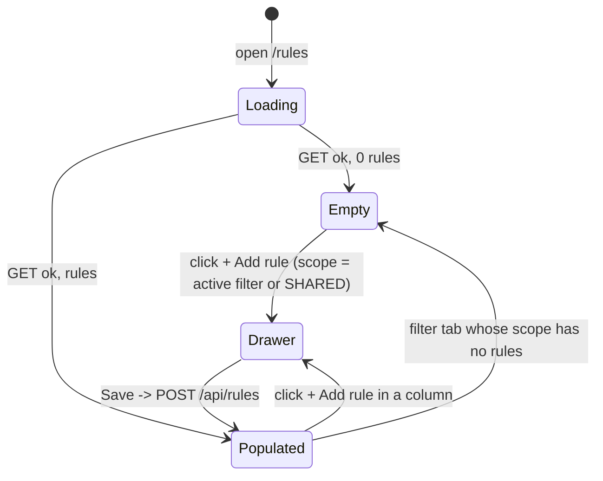

# Rules Page

## Purpose

The Rules page manages the **scoring rules** that steer every AI score (fit,
success, overall) for jobs and companies. Each rule has a single `priority`
(0–100) that drives **both** its position in the list (higher first) **and** its
severity badge. Rules are grouped by scope; each scope is a separate column.

Priority is also the **weight** the LLM is told to apply when scoring
(serialized as `w:{priority}` into the scoring prompts).

---

## Page Layout

```text
┌──────────────────────────────────────────────────────────────────────────────┐
│ Scoring Rules                          (e.g. 17/20 active)                   │
│ Shared rules apply to all entity types                                       │
├──────────────────────────────────────────────────────────────────────────────┤
│ [All (17)] [Shared (4)] [Jobs (7)] [Product Company (5)] [Recruiting (4)]    │
├──────────────┬──────────────┬───────────────┬───────────────┬────────────────┤
│ SHARED Rules │  JOB Rules   │ Product Co... │ Recruiting... │                │
│ (4/4)        │  (7/7)       │   (5/5)       │   (4/4)       │                │
├──────────────┼──────────────┼───────────────┼───────────────┼────────────────┤
│ + Add rule   │ + Add rule   │ + Add rule    │ + Add rule    │                │
│ ⠿ key        │ ⠿ key        │ ⠿ key         │ ⠿ key         │                │
│  fit [Shared]│  fit [Job]   │  fit [Prod]   │  fit [Recr]   │                │
│  [Critical]  │  [High]      │  [Critical]   │  [Critical]   │                │
│  w:100       │  w:85        │  w:100        │  w:100        │                │
│  ⦿ [↑][↓][✎][🗑]│  ⦿ [↑][↓][✎][🗑]│  ⦿ [↑][↓][✎][🗑]│  ⦿ [↑][↓][✎][🗑]│     │
│  value text  │  value text  │  value text   │  value text   │                │
│  description │  description │  description  │  description  │                │
│  …           │  …           │  …            │  …            │                │
└──────────────┴──────────────┴───────────────┴───────────────┴────────────────┘
```

### Rule row anatomy

```text
⠿  key_name          fit  [Shared]  [Critical]  w:100      ⦿ [↑][↓][✎][🗑]
   How the rule matches candidates / companies
   Optional description (italic)
```

| Part          | Description                                                |
| ------------- | ---------------------------------------------------------- |
| `⠿` handle    | Drag handle — grab to reorder the whole column             |
| key           | Unique rule key (`rule_type`-scoped)                       |
| category      | `fit` or `success` badge (which score it steers)           |
| scope badge   | Shared / Job / Product / Recruiting                        |
| severity      | Badge derived from priority (see legend below)             |
| `w:{n}`       | Numeric priority — the LLM weight fed into scoring prompts |
| hover actions | Enable switch, ↑ Move up, ↓ Move down, ✎ Edit, 🗑 Delete    |
| value         | The rule instruction text                                  |
| description   | Optional, italic explanation                               |

> The header of each column shows an icon, the scope label, and an
> `enabled/total` counter (e.g. `4/4`).

---

## Priority Badge Legend

The severity badge is **computed from the rule's single `priority`** value:

| Priority | Badge    | Color   |
| -------- | -------- | ------- |
| ≥ 90     | Critical | red     |
| ≥ 75     | High     | orange  |
| ≥ 50     | Med      | neutral |
| < 50     | Low      | outline |

Priority is clamped to the range **0–100**. There is no separate weight field —
`priority` is the single source of truth for order, badge, and LLM weight.

---

## Reordering Rules

Priority = list order (descending, highest first). Reordering edits only
priorities, never other fields.

- **Move up (↑)**: the rule's priority becomes `preceding priority + 1`,
  clamped to `≤ 100`. No-op for the first rule in its column.
- **Move down (↓)**: the rule's priority becomes `following priority − 1`,
  clamped to `≥ 0`. No-op for the last rule in its column.
- **Drag-and-drop**: dragging a rule to a new position recomputes priorities
  across the whole column, redistributed from `100` down to `1` (always within
  0–100).

Only the moved rule changes on ↑/↓; neighbors keep their values. After the API
returns, the list refetches and re-sorts by priority.

See `docs/ux/flows/rules/reorder-rules.md` for the full walk-through.

---

## Filter Tabs

| Tab             | Shows                                         |
| --------------- | --------------------------------------------- |
| All             | All four scope columns                        |
| Shared          | Shared rules only (apply to all entity types) |
| Jobs            | JOB rules only                                |
| Product Company | COMPANY_PRODUCT rules only                    |
| Recruiting      | COMPANY_RECRUITING rules only                 |

Each tab shows a rule count in parentheses.

---

## Available Actions

- Add rule (opens the Add Rule drawer — see `rule-form-drawer.md`). Available
  both inside every scope column **and** from the empty state, so the first
  rule can always be created.
- Edit rule (opens the Edit Rule drawer, prefilled)
- Enable / Disable (instant toggle switch)
- Move up / Move down (reorder by priority)
- Delete (hard delete of the rule)

---

## Empty State

Rendered when the loaded rule set is empty (`rules = {}`), **and** when the
active filter's scope has no rules. It replaces the scope-column grid; the
header and filter tabs stay visible. An empty list is never a dead end — there
is always a way to create the first rule.

```text
Scoring Rules

0/0 active — Shared rules apply to all entity types

[All (0)] [Shared (0)] [Jobs (0)] [Product Company (0)] [Recruiting (0)]

        ┌──────────────────────────────────────────┐
        │                    ◎                     │
        │          No scoring rules yet            │
        │                                          │
        │   Rules weight how jobs and companies    │
        │   are scored. Add your first rule to     │
        │          tune your matches.              │
        │                                          │
        │               [ + Add rule ]             │
        └──────────────────────────────────────────┘
```

- `+ Add rule` opens the **Add Rule** drawer (see `rule-form-drawer.md`) with
  scope pre-selected: `SHARED` when the whole list is empty, otherwise the
  scope of the active filter.
- When the empty state is caused by a filter (other scopes do have rules), the
  title reads **"No rules in this scope yet"** and the copy explains that the
  rule will apply to that scope's scoring.



## Loading State

While rules are being fetched, the page shows `Loading rules...`.

## Error State

Fetch failures are swallowed silently and render as the empty state; the user
can refresh the page.

---

## Navigation

```text
Settings
   └── Rules          Scoring rules configuration
```

The Rules page is rendered by `apps/frontend/src/widgets/rules-page/index.tsx`
(which fetches `GET /api/rules`) and laid out by
`apps/frontend/src/features/rules/components/RulesTab.tsx`.
